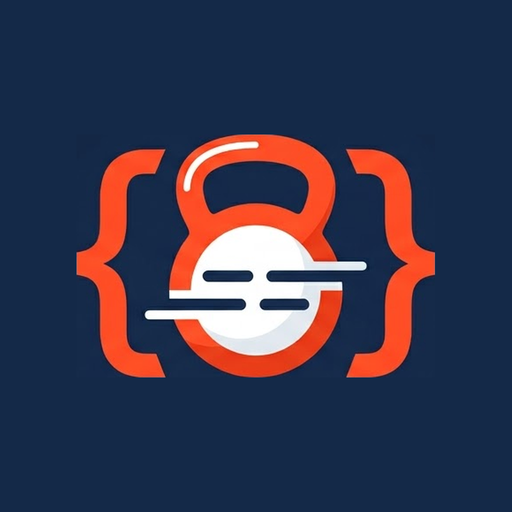

<p align="center">
  
</p>

# Code Gym

**[coding-gym.pro](https://coding-gym.pro)**

Code Gym gives you a short set of coding exercises every weekday morning,
written by an AI model from your own history. You answer, rate how hard each
one felt, and get a graded review, and the next day's set goes back to what you
missed. Most exercises train the judgment the job runs on, like reviewing code,
comparing two designs or questioning a vague spec, and you run it on your own
AI provider key.

It's for individual engineers who want a few minutes of deliberate practice
each day, alongside pairing and code review rather than in place of them. The
exercises cover Ruby on Rails and JavaScript.

- **Ten kinds of exercise.** Code review, design comparison, security review,
  architecture decisions, coding challenges, Parsons problems (put shuffled
  lines back in order), plan review, ambiguity hunts, pseudocode to code, and
  a pattern of the month.
- **Short days.** A set has 2 to 4 sections. It grows as you finish more of
  your recent sets and do well on them, and shrinks when you don't.
- **Weak spots come back.** A concept you keep struggling with shows up again
  until it sticks. Once you've got it, a retention check returns after 7 days,
  and the gap doubles each time up to 60.
- **Checked before you see it.** A second AI pass judges every drafted section
  and can fix its wording or throw it out and have it rewritten.
- **Graded on a fixed rubric.** Each answer is rated beginner, developing,
  solid or strong, against the level the section was written for.
- **Levels per kind.** Junior, mid-level, senior or principal engineer, set
  for each kind of exercise. The app suggests a step up or back from your
  results, and you can turn that off.
- **Your own key.** Anthropic, Google Gemini or OpenAI. Your account page
  shows this month's requests and tokens per provider.
- **Works on a phone.** Add it to your home screen, get a push reminder when
  your set is ready, and keep a draft answer if the connection drops.

Here is a code review exercise:

> **Code Review.** This method recalculates a customer's loyalty tier every
> time it's called, even inside a loop over the whole customer list. What's
> the issue and how would you fix it?

```ruby
def loyalty_tier(customer)
  total = customer.orders.sum(&:total_cents)
  case total
  when 0...10_000 then "bronze"
  when 10_000...50_000 then "silver"
  else "gold"
  end
end

customers.each { |c| puts loyalty_tier(c) }
```

---

## Getting started

1. Go to [coding-gym.pro](https://coding-gym.pro) and sign in with your
   email. You'll get a 6-digit code; there are no passwords. Your first
   sign-in creates your account.
2. On the Setup page, add an API key from one of these providers. The app uses
   your own key, so you pay only for your own exercises.
   - Anthropic: https://console.anthropic.com/settings/keys
   - Google Gemini: https://aistudio.google.com/apikey
   - OpenAI: https://platform.openai.com/api-keys
3. Choose your language (Ruby on Rails, JavaScript, or both on alternate days)
   and your level on the same page. Everything else there can wait.

Your set is ready at 8am on weekdays, in your time zone. If you open the
dashboard before then, it generates one on the spot.

If something is broken or confusing, open an issue or tell
[@hmccutchen](https://github.com/hmccutchen).
